# v184 visual review — awaiting owner approval

Same six example cards in all three versions. No prices or history were seeded. This is an isolated comparison collection, not the owner's data. API price and historical-series requests were blocked; real artwork and set metadata were allowed. Screenshots use Chromium, reduced motion, 390×844 and 1365×900 viewports. The original ZIP is rendered as supplied; its demo history generator was not run.

## Home · 390px
| ZIP reference | Previous main | v184 proposal |
|---|---|---|
| 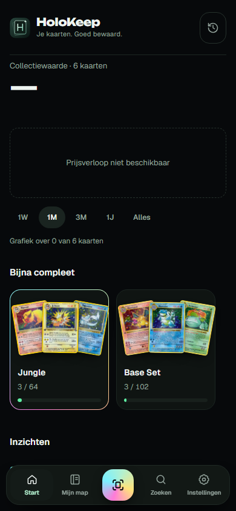 | 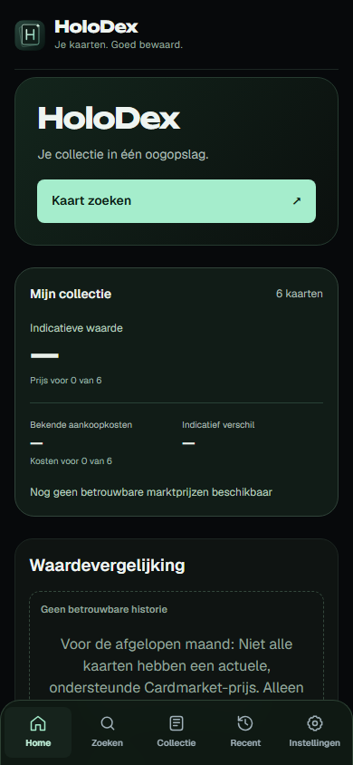 | 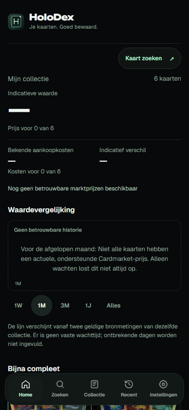 |

## Home · 1365px
| ZIP reference | Previous main | v184 proposal |
|---|---|---|
| 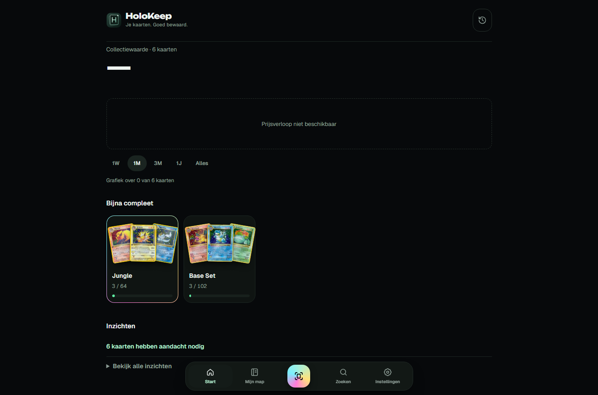 | 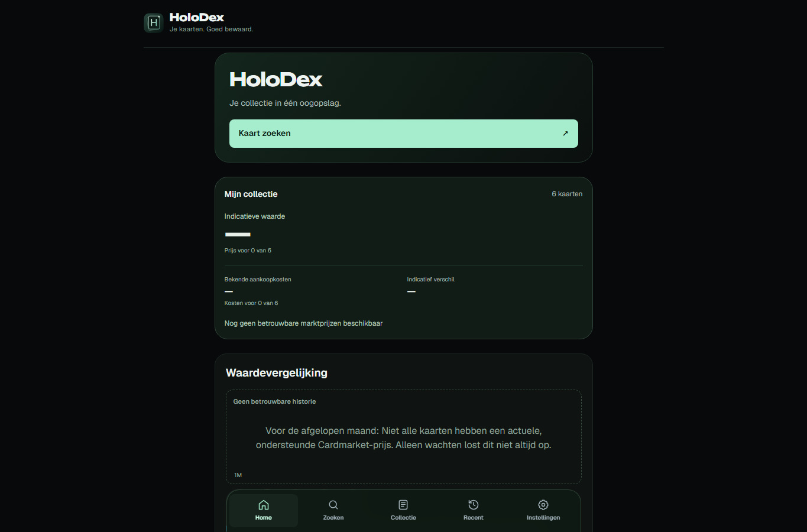 | 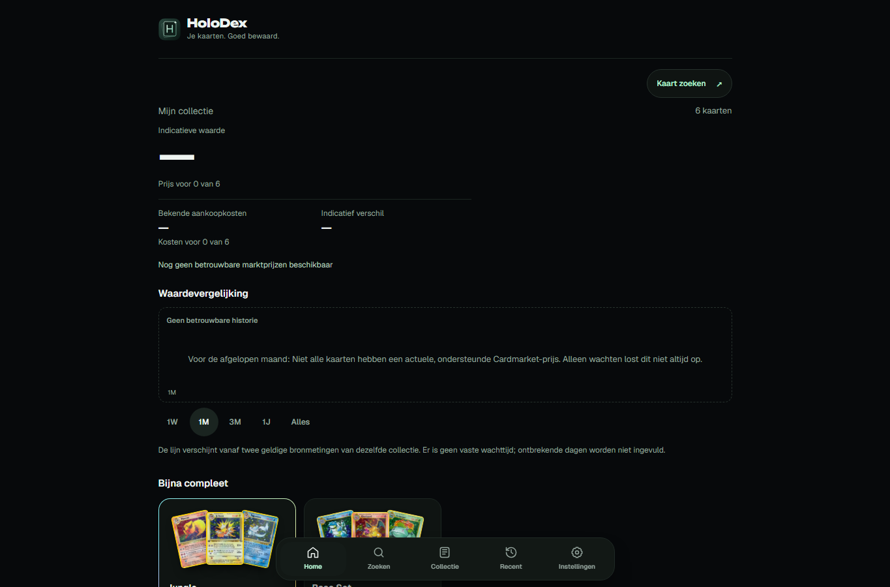 |

## Collection · 390px
| ZIP reference | Previous main | v184 proposal |
|---|---|---|
| 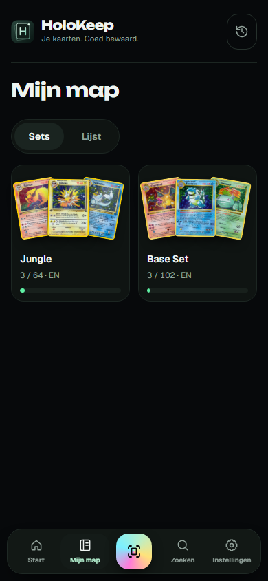 | 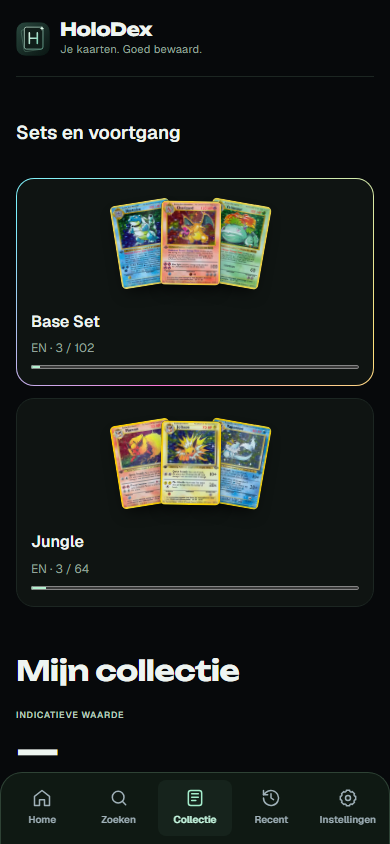 | 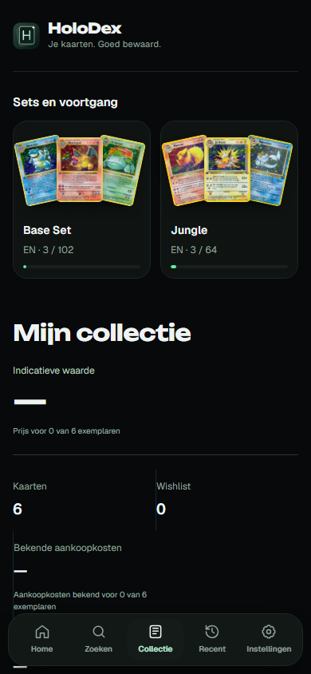 |

## Collection · 1365px
| ZIP reference | Previous main | v184 proposal |
|---|---|---|
| 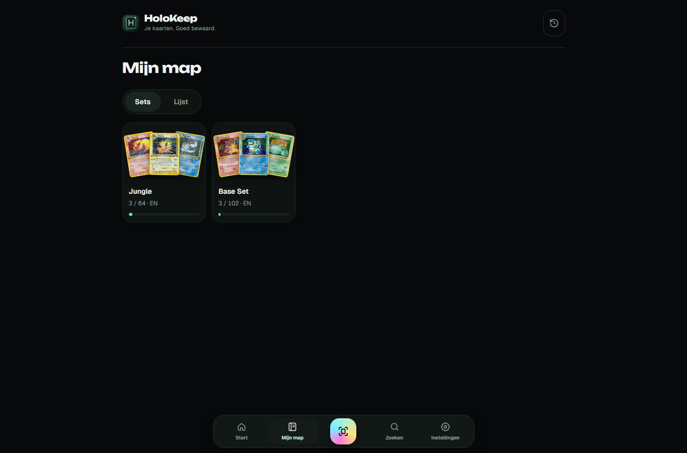 | 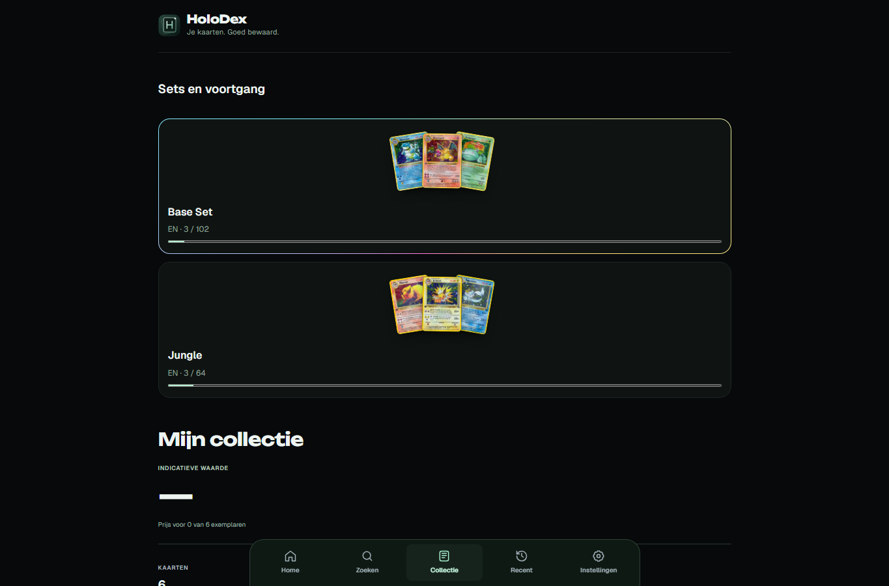 | 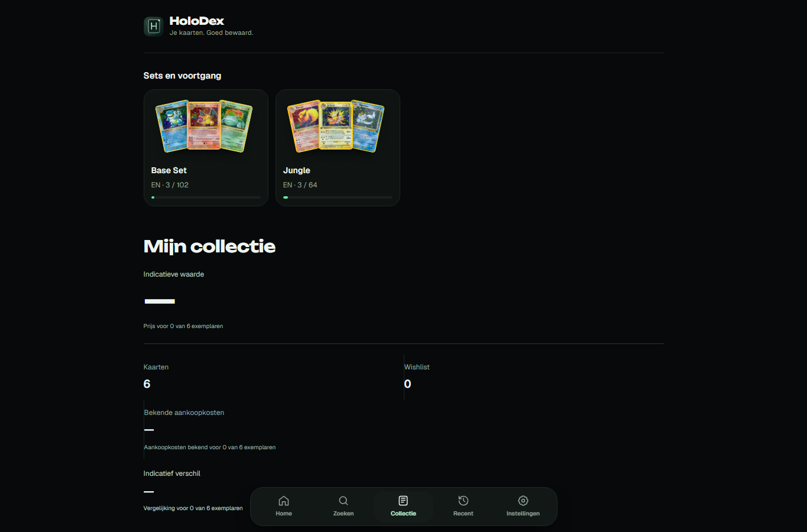 |

## Visible changes
- Open Home composition: compact search action; unboxed value and chart; no duplicated large brand banner.
- Two-column mobile set cards, four columns on desktop, card fans and thin progress tracks.
- Reference surface and control treatment: base #07090b, panel #0f1412, mint #b3f0cf, Geist/Unbounded, floating rounded navigation, desktop content width matching the reference.

## Deliberate differences
The existing five working tabs, cost/coverage information, chart validation and HoloDex branding remain. No pretend scanner, generated prices, backfilled history or invented performance. The ZIP may show different set ordering/completion because its old presentation logic is not imported. The current reliable chart still needs comparable real observations.

## Scope and validation
Production changes are CSS presentation and the service-worker cache version only. No application JavaScript, financial engines, storage or cloud contracts changed. Cache assertions retain exact checks with the new release name; inventory hashes reflect the actual source. Existing Home, history, parity and PWA browser suites: 25/25 passed, including 320/375/390/430px, natural keyboard navigation, collection persistence, offline and real worker updates. Desktop captures have no page exceptions or horizontal overflow. Actual iPhone hardware not tested.

Do not merge before visual approval.
